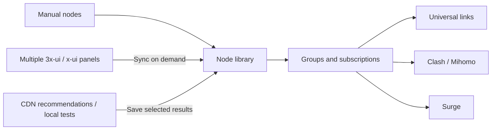

<div align="center">
  
  <h1>sublinkX</h1>
  <p><strong>Your nodes, organized. Your subscriptions, ready.</strong></p>
  <p>A self-hosted workspace for node management, subscription generation, and CDN IP selection.</p>
  <p>
    <a href="https://github.com/wangxvwei/sublinkX/actions/workflows/docker-image.yml"></a>
    <a href="go.mod"></a>
    <a href="webs/package.json"></a>
    <a href="https://github.com/wangxvwei/sublinkX/pkgs/container/sublinkx"></a>
    <a href="LICENSE"></a>
  </p>
  <p><a href="README.md">简体中文</a> · <strong>English</strong></p>
  <p><a href="#features">Features</a> · <a href="#quick-start">Quick start</a> · <a href="#cdn-ip-selection">CDN IP selection</a> · <a href="#updates-and-backups">Updates</a> · <a href="#acknowledgements">Acknowledgements</a></p>
</div>

---

sublinkX brings manually added nodes, nodes from multiple 3x-ui / x-ui panels, and generated CDN nodes into one workspace. Manage sources, groups, node order, and client subscriptions in a web interface designed for a NAS or other self-hosted installation.

This repository continues development from [gooaclok819/sublinkX](https://github.com/gooaclok819/sublinkX), adding multiple panel sources, node rewrite rules, independent CDN profiles, a guided subscription editor, and web updates. See [Acknowledgements](#acknowledgements) for the upstream projects, components, and data providers used here.

## Features

| | Feature | What you can do |
| --- | --- | --- |
| 🗂️ | **One node library** | Add nodes manually, filter groups, select in batches, and identify their sources |
| 🔌 | **Multiple panel sources** | Connect panels using SSH credentials or a supported 3x-ui API Token, then synchronize on demand |
| 🛠️ | **Node rewrite rules** | Adjust addresses, ports, TLS, SNI, Host, and paths; replace local addresses from remote subscriptions |
| 🌐 | **CDN recommendations and testing** | Identify a target network from its public IP, or measure supplied CDN IPs locally; request 5–10 results |
| 📋 | **Subscription editor** | Choose nodes by source, drag to reorder, and export universal links, Clash / Mihomo, or Surge configurations |
| 🏠 | **NAS deployment** | Docker Compose, persistent SQLite storage, version checks, and one-click web updates |
| 📱 | **Desktop and mobile** | Responsive pages, guided editing, subscription QR codes, and access records |

## How it works



## Quick start

### Docker Compose

On a device with Git, Docker, and Docker Compose installed:

```bash
git clone https://github.com/wangxvwei/sublinkX.git sublinkx
cd sublinkx
docker compose up -d
```

Open `http://YOUR_DEVICE_IP:8000`, or `http://localhost:8000` on the same computer.

| Initial login | Default |
| --- | --- |
| Username | `admin` |
| Password | `123456` |

Change the password after your first login. Existing databases retain their existing accounts.

> [!NOTE]
> The official image is `ghcr.io/wangxvwei/sublinkx:latest`, currently published for **Linux / amd64**. See [VERSION](VERSION) for the application version and [GitHub Actions](https://github.com/wangxvwei/sublinkX/actions/workflows/docker-image.yml) for build history.

The supplied [docker-compose.yml](docker-compose.yml) enables web updates with a Docker socket mount and `user: root`. This grants the application control over the host Docker daemon; keep the admin interface on a trusted network or behind access protection. For manual updates only, remove the socket mount and associated `user: root` setting, and make sure the mounted directories are writable by the container user.

For a NAS container manager, import that Compose file, map a host port to container port `8000/TCP`, and retain the persistent volume mounts.

### First steps

1. **Add sources**: Add nodes in the node library, or connect a panel under source management and synchronize it.
2. **Organize nodes**: Review source labels, assign groups, and configure address or transport rewrite rules as needed.
3. **Create a subscription**: Choose nodes, arrange their order, and configure client output in the subscription editor.
4. **Import into your client**: Copy the subscription URL or scan its QR code. Open the CDN page when you need CDN node variants.

See the [3x-ui / x-ui integration guide](docs/multi-xui-docker.md) for detailed steps in Chinese. SSH synchronization requires Python 3 on the remote device and access to its x-ui database and subscription service.

## CDN IP selection

### Choose the mode that matches your network

| Mode | Your input | Processing | What the results mean |
| --- | --- | --- | --- |
| **Remote-network recommendations** | A public IPv4 address from the target location, a CDN template, and optionally an ISP override | Identify the location and ISP, match public recommendations, and validate IPs against Cloudflare's official ranges | **General ISP recommendations; not measurements from the target province** |
| **Local testing** | Candidate CDN IPs, a CDN template, and test thresholds | Run CloudflareSpeedTest from the sublinkX device, then check TLS using the template's SNI | Measurements from the device's actual network egress |

You can enter a public IP from another province while running the application elsewhere. The public IP identifies the target network; candidate CDN IPs are the connection destinations.

> [!IMPORTANT]
> Recommendations do not run tests through the entered IP and do not guarantee speed or proxy availability at that location. Local tests describe the host device's network egress. Verify the complete proxy connection in the client and network where it will be used.

### Independent profiles for every location

- Use **New profile** or **Copy as new profile** to add locations such as `Campus`, `Home`, or `Travel`. Each profile stores its own settings, results, and nodes.
- **The profile name is the node group name**. Generated nodes use names such as `Campus · 01` and `Campus · 02`.
- Change an existing profile's name with the separate **Rename** action. Creating another location creates a separate profile identity.
- **Update to the N selected nodes** replaces that profile's saved batch with your selection, so older batches do not accumulate.
- Existing node IDs are reused where possible to maintain subscription membership. Other profiles and original nodes are managed independently.

### Multiple sources and recommendation history

Recommendations use the public UOUIN, WeTest, and CFYes feeds through BestCF mirrors. Provider identities are kept separate from mirror URLs, so mirrors of the same provider do not earn extra credit. A failed provider does not stop usable providers; the page shows each feed's timestamp, matching count, and errors.

- **Freshness**: Data older than 48 hours, or with invalid timestamps, is excluded. Recent records rank higher.
- **Outage fallback**: If a provider request fails, use its latest persisted snapshot only while it remains within 48 hours. Cached results are labeled with the original timestamp; expired cache is excluded.
- **History**: Each recommendation run records public observations for the last seven days. Records are deduplicated by the provider timestamp's 30-minute window; refreshes, restarts, or another profile do not inflate history.
- **Ranking and diversity**: Combine provider-relative rank, freshness, support from multiple providers, and historical consistency, with moderate IPv4 subnet diversity.
- **Keep known-good IPs**: Mark a result to prioritize it in future runs, even when current public feeds omit it. Changing the target IP, ISP, template, or mode clears retention; copying a profile starts without retained IPs. The nodes saved to the library still follow the current selection.

History starts accumulating with recommendation runs after the upgrade. Initial runs show limited history. Provider measurements are not displayed as measurements from the target network, and the ranking is not a speed prediction.

### Templates and limits

| Original node | Supported transport |
| --- | --- |
| VLESS + TLS | WebSocket, XHTTP, gRPC |
| VMess + TLS | WebSocket |
| Trojan + TLS | WebSocket |

Generated links preserve authentication, port, SNI, Host, path, and extension parameters. Copy the results, export a TXT file, save them to the node library, or add them to an existing subscription.

Request **5–10 results**; the application shows the actual count when fewer qualify. Local mode accepts up to **4,096 IPv4 / IPv6 addresses** through text input or a TXT file, without expanding CIDR ranges. Each instance runs one CDN task at a time and stores task status and results in its database.

The official Docker image includes **CloudflareSpeedTest v2.3.5**. For a standalone binary installation, place `cfst` on `PATH` or point `CFST_PATH` to it. Remote-network recommendations currently support Cloudflare only.

## Client output

| Format | Supported scope |
| --- | --- |
| **Universal / V2Ray** | A Base64-encoded collection of node links for clients supporting this subscription format |
| **Clash / Mihomo** | SS, SSR, Trojan, VMess, VLESS, Hysteria, Hysteria 2, and TUIC; includes XHTTP field output |
| **Surge** | SS, Trojan, VMess, Hysteria 2, and TUIC |

Protocol and transport availability depend on the client's core and version. Manage Clash and Surge configuration templates in the output template page.

## Updates and backups

### Web updates

Open the version update page under system management, compare the current and latest image versions, and confirm the one-click update. This requires the Docker socket permissions configured in Compose.

If an old interface remains after an upgrade, press `Ctrl + F5` to refresh and reopen the profile.

### Command-line updates

Run from the directory containing your Compose file:

```bash
docker compose pull sublinkx
docker compose up -d sublinkx
```

### Persistent storage

| Host directory | Container path | Contents |
| --- | --- | --- |
| `./db` | `/app/db` | SQLite database, accounts, application settings, source settings, and CDN profiles |
| `./template` | `/app/template` | Client configuration templates |
| `./logs` | `/app/logs` | Runtime logs |

Back up `db` and `template`. Stop the application before copying its SQLite database, or use a backup method that takes a consistent SQLite snapshot. Backups may contain node and source credentials; store them securely.

## Technology and development

| Layer | Main components |
| --- | --- |
| Backend | Go, Gin, GORM, SQLite, Go SSH |
| Admin interface | Vue 3, TypeScript, Vite, Element Plus, Pinia, Vue Router |
| UI components | ECharts, VueDraggablePlus, qrcode.vue |
| CDN measurements | CloudflareSpeedTest as a separate CLI process |
| Delivery | Docker multi-stage builds, GitHub Actions, GitHub Container Registry |

Build an image containing the frontend and test engine from source:

```bash
docker build --build-arg APP_VERSION="$(cat VERSION)" -t sublinkx:local .
```

The build compiles the frontend, runs Go tests, and packages the application. Run the Go tests separately with:

```bash
go test ./...
```

Report bugs through [Issues](https://github.com/wangxvwei/sublinkX/issues) or submit a pull request. Include the application version, deployment method, client, and reproduction steps, while redacting credentials, subscription tokens, and complete node links.

## Acknowledgements

### Upstream projects and tools

Thank you to the authors, contributors, and maintainers whose work makes this project possible.

| Project | Role in this repository |
| --- | --- |
| [gooaclok819/sublinkX](https://github.com/gooaclok819/sublinkX) | **Direct upstream** and the foundation for node and subscription management |
| [jaaksii/sublink](https://github.com/jaaksii/sublink) | The subscription conversion project on which the original sublinkX was based |
| [youlaitech/vue3-element-admin](https://github.com/youlaitech/vue3-element-admin) | The admin frontend framework and interface foundation |
| [PanJiaChen/vue-element-admin](https://github.com/PanJiaChen/vue-element-admin) | Components and assets retained through the frontend template; its copyright notice is preserved |
| [XIU2/CloudflareSpeedTest](https://github.com/XIU2/CloudflareSpeedTest) | **Local CDN measurement engine**, invoked as a separate command-line process |

We also thank the frameworks and components used directly:

- **Backend**: [Gin](https://github.com/gin-gonic/gin), [GORM](https://github.com/go-gorm/gorm), [glebarez/sqlite](https://github.com/glebarez/sqlite), [Go SSH](https://pkg.go.dev/golang.org/x/crypto/ssh), [base64Captcha](https://github.com/mojocn/base64Captcha), [jwt-go](https://github.com/dgrijalva/jwt-go), and [go-yaml](https://github.com/go-yaml/yaml).
- **Frontend**: [Vue](https://github.com/vuejs/core), [Vite](https://github.com/vitejs/vite), [Element Plus](https://github.com/element-plus/element-plus), [Pinia](https://github.com/vuejs/pinia), [Vue Router](https://github.com/vuejs/router), [Axios](https://github.com/axios/axios), [Apache ECharts](https://github.com/apache/echarts), [VueDraggablePlus](https://github.com/Alfred-Skyblue/vue-draggable-plus), and [qrcode.vue](https://github.com/scopewu/qrcode.vue).
- **Build and deployment**: [Docker](https://www.docker.com/), [GitHub Actions](https://github.com/features/actions), and [Watchtower](https://github.com/containrrr/watchtower). Watchtower is an optional auto-update service in the Compose file.

See [go.mod](go.mod) and [webs/package.json](webs/package.json) for the dependency lists.

### Data and lookup providers

| Service | Role in this repository |
| --- | --- |
| [UOUIN](https://api.uouin.com/cloudflare.html) / [public mirror](https://bestcf.pages.dev/uouin/all.txt) | ISP recommendations and provider-relative ranking |
| [WeTest](https://www.wetest.vip/) / [public mirror](https://bestcf.pages.dev/wetest/ipv4.txt) | Another source of ISP recommendations |
| [CFYes public mirror](https://bestcf.pages.dev/cfyes/ipv4.txt) | CFYes ISP recommendations |
| [BestCF](https://bestcf.pages.dev/) | Mirrors and snapshot timestamps for these public lists |
| [PConline IP lookup](https://whois.pconline.com.cn/) | Location and ISP lookup for the entered public IP |
| [ipapi.is](https://ipapi.is/) | ASN information used as a fallback when the ISP cannot be determined |
| [Cloudflare official IP ranges](https://www.cloudflare.com/ips/) | Validate whether recommended IPs belong to Cloudflare's official ranges |

These services are queried when needed. Their availability, update schedules, and limits are controlled by their providers. Thank you to those maintaining these resources and to everyone reporting issues and contributing improvements.

## License

This repository's code is distributed under the [MIT License](LICENSE). Upstream copyright and license notices are retained. Third-party components remain subject to their own licenses.

CloudflareSpeedTest, bundled in the image, uses **GNU GPL v3**. Its license and corresponding source archive are included in the image. See [THIRD_PARTY_NOTICES.md](THIRD_PARTY_NOTICES.md) for frontend notices, source locations, and engine build instructions.
