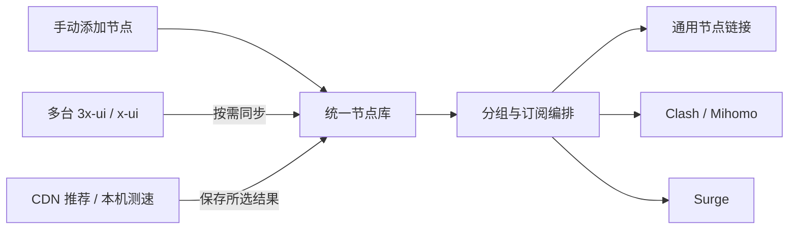

<div align="center">
  
  <h1>sublinkX</h1>
  <p><strong>把分散的节点，整理成顺手的订阅。</strong></p>
  <p>面向 NAS 与自托管环境的节点管理、订阅生成和 CDN 优选工具。</p>
  <p>
    <a href="https://github.com/wangxvwei/sublinkX/actions/workflows/docker-image.yml"></a>
    <a href="go.mod"></a>
    <a href="webs/package.json"></a>
    <a href="https://github.com/wangxvwei/sublinkX/pkgs/container/sublinkx"></a>
    <a href="LICENSE"></a>
  </p>
  <p><strong>简体中文</strong> · <a href="README.en-US.md">English</a></p>
  <p><a href="#功能一览">功能一览</a> · <a href="#快速开始">快速开始</a> · <a href="#cdn-优选">CDN 优选</a> · <a href="#更新与备份">更新与备份</a> · <a href="#致谢">致谢</a></p>
</div>

---

sublinkX 将手动添加的节点、多台 3x-ui / x-ui 面板的节点，以及生成的 CDN 节点汇集到一个工作空间。通过网页完成来源接入、分组、节点排序和订阅输出，适合部署在 NAS 上集中维护。

本仓库基于 [gooaclok819/sublinkX](https://github.com/gooaclok819/sublinkX) 继续开发，补充了多来源接入、节点改写、独立 CDN 优选配置、订阅编辑流程和网页更新能力。项目的上游来源、使用的组件与数据服务见下方[致谢](#致谢)。

## 功能一览

| | 功能 | 你可以做什么 |
| --- | --- | --- |
| 🗂️ | **统一节点库** | 手动添加、分组筛选、批量选择，查看节点所属来源 |
| 🔌 | **多面板接入** | 通过 SSH 账号密码或受支持的 3x-ui API Token 接入多台面板，按需同步 |
| 🛠️ | **节点改写** | 根据规则调整地址、端口、TLS、SNI、Host 与路径，处理订阅中的本地地址 |
| 🌐 | **CDN 推荐与测速** | 按目标公网 IP 识别线路，或对给定 CDN IP 进行本机测速，目标数量 5–10 个 |
| 📋 | **订阅编排** | 按来源选择节点、拖动排序，生成通用链接、Clash / Mihomo 与 Surge 配置 |
| 🏠 | **适合 NAS 部署** | Docker Compose 部署、SQLite 数据持久化、版本检查与网页一键更新 |
| 📱 | **桌面与手机操作** | 响应式页面、分步订阅编辑、订阅二维码与访问记录 |

## 工作方式



## 快速开始

### Docker Compose

在安装了 Git、Docker 和 Docker Compose 的设备上运行：

```bash
git clone https://github.com/wangxvwei/sublinkX.git sublinkx
cd sublinkx
docker compose up -d
```

浏览器访问 `http://你的设备IP:8000`，同一台电脑可访问 `http://localhost:8000`。

| 初始登录 | 默认值 |
| --- | --- |
| 用户名 | `admin` |
| 密码 | `123456` |

首次登录后请修改密码。已有数据库会继续使用原来的账号。

> [!NOTE]
> 正式镜像为 `ghcr.io/wangxvwei/sublinkx:latest`，当前发布平台为 **Linux / amd64**。具体版本见 [VERSION](VERSION)，构建记录见 [GitHub Actions](https://github.com/wangxvwei/sublinkX/actions/workflows/docker-image.yml)。

仓库中的 [docker-compose.yml](docker-compose.yml) 已配置网页一键更新，包含 Docker socket 挂载和 `user: root`。这使应用能够控制宿主机 Docker；管理后台应置于可信网络或访问保护之后。只需手动更新时，可以移除 socket 挂载及对应的 `user: root` 配置，并确保挂载目录对容器用户可写。

通过 NAS 图形界面部署时，可导入上述 Compose 文件，将宿主机端口映射到容器的 `8000/TCP`，并保留数据目录挂载。

### 第一次使用

1. **接入节点**：在「资源中心 → 节点库」手动添加节点，或从「来源接入」添加面板并同步。
2. **整理资源**：查看来源、设置分组，按需配置节点地址与传输参数改写。
3. **创建订阅**：在「订阅中心 → 我的订阅」选择节点、调整顺序并设置客户端输出。
4. **导入客户端**：复制订阅地址或扫描二维码；需要 CDN 节点时，进入「资源中心 → CDN 优选」。

多面板接入的详细步骤见 [3x-ui / x-ui 接入指南](docs/multi-xui-docker.md)。SSH 方式需要远程设备具备 Python 3，并能读取对应的 x-ui 数据库与订阅服务。

## CDN 优选

### 两种方式，按使用场景选择

| 方式 | 你提供什么 | 系统如何处理 | 结果代表什么 |
| --- | --- | --- | --- |
| **异地线路推荐** | 目标地区公网 IPv4、原始 CDN 节点；运营商可手动指定 | 识别归属地与运营商，匹配公开推荐数据，并校验地址属于 Cloudflare 官方网段 | **同运营商通用推荐，非目标省份实测** |
| **本机测速** | 一组候选 CDN IP、原始 CDN 节点及筛选条件 | 由运行 sublinkX 的设备调用 CloudflareSpeedTest 测试，再校验原节点 SNI 的 TLS 连接 | 当前设备实际出口的测速结果 |

人在 A 省，也可以填写 B 省用户的公网 IP 获取线路推荐。这个公网 IP 用于识别目标线路；候选 CDN IP 则是连接目标，两者用途不同。

> [!IMPORTANT]
> 异地推荐不会远程借用目标 IP 测速，也不保证目标地区的速度或代理可用性。本机测速同样只代表运行设备的网络出口；完整代理连接需在实际使用的客户端中验证。

### 每个地点，独立维护

- 用「**新建配置**」或「**复制为新配置**」增加地点，例如「校园优选」「家里优选」「出差优选」。各配置独立保存输入条件、结果和节点。
- **配置名称就是节点分组名称**，节点统一命名为 `校园优选 · 01`、`校园优选 · 02` 等。
- 已保存的名称通过「**重命名**」单独修改，新增地点时会创建新的配置身份。
- 点击「**更新为选中的 N 个节点**」，将当前配置的节点更新为本次所选数量，旧批次不会继续累积。
- 更新时保留可复用的节点 ID，维护已有订阅关联；其他配置与原始节点独立保存。

### 模板与测速范围

| 原始节点 | 支持的传输 |
| --- | --- |
| VLESS + TLS | WebSocket、XHTTP、gRPC |
| VMess + TLS | WebSocket |
| Trojan + TLS | WebSocket |

生成链接保留原节点的认证、端口、SNI、Host、路径及扩展参数。结果可以复制、导出 TXT、保存到节点库，并按需加入已有订阅。

目标结果为 **5–10 个**；数量不足时显示实际结果。本机模式支持逐行输入或导入 TXT，每次最多 **4096 个 IPv4 / IPv6 地址**，当前不展开 CIDR。每个实例同时运行一个优选任务，任务状态与结果保存在数据库中。

Docker 正式镜像内置 **CloudflareSpeedTest v2.3.5**。直接运行二进制时，将 `cfst` 放入 `PATH`，或设置 `CFST_PATH` 指向该程序。异地线路推荐当前仅支持 Cloudflare。

## 客户端输出

| 输出格式 | 支持范围 |
| --- | --- |
| **通用 / V2Ray** | 将节点链接集合编码为 Base64，供支持此订阅格式的客户端导入 |
| **Clash / Mihomo** | SS、SSR、Trojan、VMess、VLESS、Hysteria、Hysteria 2、TUIC；包含 XHTTP 字段输出 |
| **Surge** | SS、Trojan、VMess、Hysteria 2、TUIC |

具体协议和传输能否使用，取决于客户端及其内核版本。Clash 和 Surge 的配置模板可在「订阅中心 → 输出模板」中管理。

## 更新与备份

### 网页更新

进入「**系统管理 → 版本更新**」，检查当前版本与最新镜像版本，确认后点击「一键更新」。此功能需要 Compose 中配置的 Docker socket 权限。

升级后如果仍显示旧页面，可按 `Ctrl + F5` 强制刷新，再重新打开对应配置。

### 命令行更新

在 Compose 文件所在目录运行：

```bash
docker compose pull sublinkx
docker compose up -d sublinkx
```

### 持久化目录

| 宿主机目录 | 容器路径 | 内容 |
| --- | --- | --- |
| `./db` | `/app/db` | SQLite 数据库、账号与应用配置、来源和 CDN 配置 |
| `./template` | `/app/template` | 客户端配置模板 |
| `./logs` | `/app/logs` | 运行日志 |

备份时保留 `db` 与 `template`；复制 SQLite 数据库前先停止服务，或使用支持 SQLite 一致性快照的备份方式。备份中可能包含节点和来源凭据，请妥善保存。

## 技术与开发

| 层级 | 主要技术 |
| --- | --- |
| 服务端 | Go、Gin、GORM、SQLite、Go SSH |
| 管理界面 | Vue 3、TypeScript、Vite、Element Plus、Pinia、Vue Router |
| 界面组件 | ECharts、VueDraggablePlus、qrcode.vue |
| CDN 测速 | 独立调用 CloudflareSpeedTest CLI |
| 构建发布 | Docker 多阶段构建、GitHub Actions、GitHub Container Registry |

从源码构建包含前端与测速引擎的镜像：

```bash
docker build --build-arg APP_VERSION="$(cat VERSION)" -t sublinkx:local .
```

构建流程会编译前端、执行 Go 测试并打包应用。Go 测试也可单独运行：

```bash
go test ./...
```

欢迎通过 [Issues](https://github.com/wangxvwei/sublinkX/issues) 反馈问题，或提交 Pull Request。反馈时请注明应用版本、部署方式、客户端与复现步骤，并隐藏账号、订阅 Token 和完整节点链接。

## 致谢

### 项目来源与开源工具

感谢以下项目的作者、贡献者及维护者，让本项目能够在已有工作之上继续完善。

| 项目 | 在本项目中的用途 |
| --- | --- |
| [gooaclok819/sublinkX](https://github.com/gooaclok819/sublinkX) | **本仓库直接上游**，提供节点与订阅管理的基础实现 |
| [jaaksii/sublink](https://github.com/jaaksii/sublink) | 原 sublinkX 所基于的订阅转换项目 |
| [youlaitech/vue3-element-admin](https://github.com/youlaitech/vue3-element-admin) | 管理端前端框架与界面基础 |
| [PanJiaChen/vue-element-admin](https://github.com/PanJiaChen/vue-element-admin) | 前端模板沿用的部分组件与资源；仓库保留其版权声明 |
| [XIU2/CloudflareSpeedTest](https://github.com/XIU2/CloudflareSpeedTest) | **本机 CDN 测速引擎**，以独立命令行进程调用 |

同时感谢直接使用的框架与组件：

- **服务端**：[Gin](https://github.com/gin-gonic/gin)、[GORM](https://github.com/go-gorm/gorm)、[glebarez/sqlite](https://github.com/glebarez/sqlite)、[Go SSH](https://pkg.go.dev/golang.org/x/crypto/ssh)、[base64Captcha](https://github.com/mojocn/base64Captcha)、[jwt-go](https://github.com/dgrijalva/jwt-go) 与 [go-yaml](https://github.com/go-yaml/yaml)。
- **前端**：[Vue](https://github.com/vuejs/core)、[Vite](https://github.com/vitejs/vite)、[Element Plus](https://github.com/element-plus/element-plus)、[Pinia](https://github.com/vuejs/pinia)、[Vue Router](https://github.com/vuejs/router)、[Axios](https://github.com/axios/axios)、[Apache ECharts](https://github.com/apache/echarts)、[VueDraggablePlus](https://github.com/Alfred-Skyblue/vue-draggable-plus) 与 [qrcode.vue](https://github.com/scopewu/qrcode.vue)。
- **构建与部署**：[Docker](https://www.docker.com/)、[GitHub Actions](https://github.com/features/actions) 与 [Watchtower](https://github.com/containrrr/watchtower)；Watchtower 为 Compose 中可选的自动更新服务。

完整依赖以 [go.mod](go.mod) 和 [webs/package.json](webs/package.json) 为准。

### 数据与查询服务

| 服务 | 在本项目中的用途 |
| --- | --- |
| [麒麟优选](https://api.uouin.com/cloudflare.html) / [BestCF 公开镜像](https://bestcf.pages.dev/uouin/all.txt) | 异地线路推荐使用的公开运营商推荐数据；实际从 BestCF 镜像读取 |
| [太平洋网络 IP 查询](https://whois.pconline.com.cn/) | 查询目标公网 IP 的地区与运营商信息 |
| [ipapi.is](https://ipapi.is/) | 当初步查询无法确定运营商时，辅助参考 ASN 信息 |
| [Cloudflare 官方地址段](https://www.cloudflare.com/ips/) | 校验推荐地址是否属于 Cloudflare 官方网段 |

上述服务按实际请求使用，数据可用性、更新时间与限制由各提供方决定。感谢维护者持续提供公开资源，也感谢反馈问题和参与改进的每一位使用者。

## 许可证

本仓库代码使用 [MIT License](LICENSE)。上游版权与许可证声明予以保留；第三方组件分别遵循其自身许可证。

镜像内附带的 CloudflareSpeedTest 使用 **GNU GPL v3**，其许可证与对应源码归档随镜像提供。前端模板的版权声明及测速引擎的源码位置、构建方法见 [THIRD_PARTY_NOTICES.md](THIRD_PARTY_NOTICES.md)。
